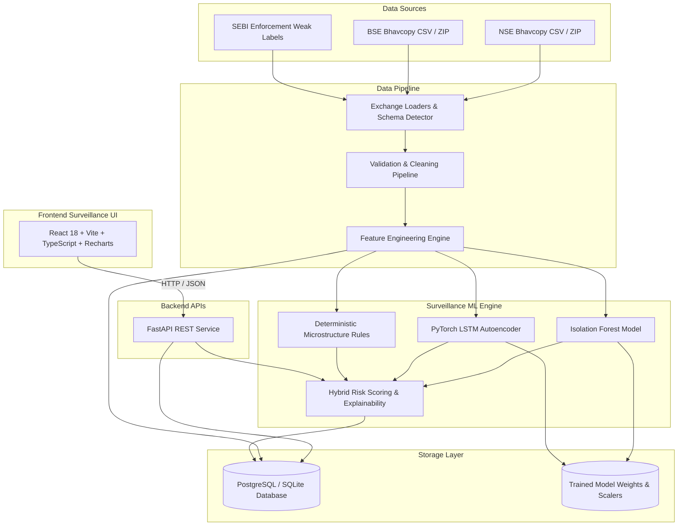

# System Architecture

## Architecture Diagram

---

## Component Separation of Concerns
1. **Data Ingestion (`backend/data_pipeline/ingestion/`):** Exchange-specific adapters for NSE (legacy and UDiFF format) and BSE, plus SEBI weak-label ingestion.
2. **Preprocessing (`backend/data_pipeline/preprocessing/`):** Validation of OHLC price bounds ($High \ge Low, High \ge Open, High \ge Close$), date parsing, deduplication, and `TimeSeriesNormalizer`.
3. **Feature Engineering (`backend/data_pipeline/feature_engineering/`):** 16 core price, volume, and microstructure features computed with zero look-ahead bias.
4. **Machine Learning (`backend/ml/`):** Isolation Forest and PyTorch LSTM Autoencoder trained with chronological data splits.
5. **Backend REST API (`backend/app/`):** Modular FastAPI routers using Pydantic schemas, dependency injection, and SQLAlchemy 2.0 ORM.
6. **Frontend UI (`frontend/`):** Dark financial terminal styled with Tailwind CSS, Recharts, and TypeScript.
